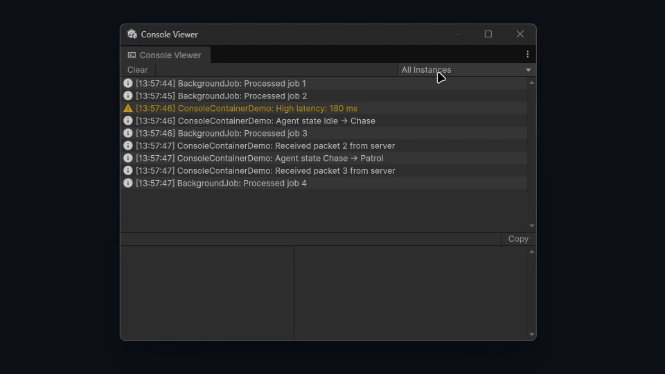

### About ConsoleContainer

Named, per-system log containers for Unity that keep debug output out of the Unity Console and in a searchable viewer with clickable call stacks.

Create a `ConsoleInstance` for each system, such as Networking, AI or Save System, and log through it from any thread. The Console Viewer window shows one instance or every instance merged in chronological order, with type filters, search, and stack frames that open in your IDE, while the Unity Console stays reserved for engine and third-party output.

It is built for production: messages raise events in player builds too, so an error can drive a soft-crash screen or a crash reporter. Dropped messages cost nothing in builds, the editor bounds its history, and a misbehaving handler can never crash the process. It behaves identically under Mono and IL2CPP, on desktop, mobile and WebGL.



### Features

1. Per-system named console instances
2. Viewer with merged chronological view
3. Clickable call stacks into your IDE
4. Search, type filters and counts
5. Message and error events in builds
6. Exception logging with throw-site stacks
7. Thread-safe logging from any thread
8. Zero-allocation dropped messages
9. Bounded editor history per instance
10. Per-type forwarding to the Unity log
11. Test Runner visibility during test runs
12. Project Settings page, runtime overrides

Detailed about features - see [FEATURES.md](Documentation/FEATURES.md). How the package is tested - see [TESTING.md](Documentation/TESTING.md).

### Performance

**Dropped messages cost nothing in builds.** In an IL2CPP release player on an Intel Core i7-12700K, a message that is neither forwarded nor observed costs 21 ns and allocates nothing. A handler receiving it costs about 190 ns and one ~100-byte message object, and forwarding costs what Unity's own `Debug.Log` does.

**The editor pays for call stacks, not for logging.** Without a call stack a message costs 0.2 µs; capturing one is Mono's stack walk, at roughly 3 to 5 µs per managed frame. Each distinct stack is stored once, so a message retains about 125 bytes plus its text, and the virtualized viewer takes in a burst of 10,000 messages in under 2 ms.

Detailed about performance - see [PERFORMANCE.md](Documentation/PERFORMANCE.md).

### Requirements

1. Unity 2022.3 LTS or newer, including Unity 6.
2. Mono or IL2CPP scripting backend.
3. No package dependencies.

### Limitations

1. Call stacks are captured in the editor only.
2. Player builds keep no message history.
3. The viewer is an editor window, not in-game.
4. Handlers run on the logging thread.
5. Messages are text, without structured fields.

### How to install

1. **Git URL.** In Unity, open **Window ▸ Package Manager ▸ + ▸ Add package from git URL…** and enter `https://github.com/reromanlee/ConsoleContainer.git?path=/UnityPackage#1.0.0`. Drop `#1.0.0` to track the latest `main` instead of a release.
2. **Manifest.** Add the same URL to `Packages/manifest.json`:

   ```json
   {
     "dependencies": {
       "com.reromanlee.consolecontainer": "https://github.com/reromanlee/ConsoleContainer.git?path=/UnityPackage#1.0.0"
     }
   }
   ```

3. **Tarball.** Download `com.reromanlee.consolecontainer-1.0.0.tgz` from the [latest release](https://github.com/reromanlee/ConsoleContainer/releases/latest), then choose **+ ▸ Add package from tarball…** in the Package Manager.

The **Console Container Demo** sample can then be imported from the package's **Samples** tab in the Package Manager.

### How to use

**Create one instance per system and log through it.** The source is a string, a type, or `this`, which shows as its type name; content arguments are joined with spaces. Dispose the instance when its owner goes away.

```csharp
using reromanlee.ConsoleContainer;

public sealed class NetworkService
{
    private readonly IConsoleInstance console = new ConsoleInstance("Networking");

    public void Connect(string host)
    {
        console.CreateText(this, "Connecting to", host);    // NetworkService: Connecting to …
        console.CreateWarning("Socket", "Latency high");     // Socket: Latency high
    }
}
```

**React to what you log, in the editor and in builds.** `ErrorCreated` and `MessageCreated` fire on the logging thread, and the static `ConsoleInstance.Created` reaches every instance the application will ever create. `CreateException` keeps the exception and the stack where it was thrown.

```csharp
ConsoleInstance.Created += instance => instance.ErrorCreated += message => SoftCrashScreen.Show(message.Label);

try { socket.Connect(host); }
catch (SocketException exception) { console.CreateException(this, exception); }
```

**Open Window ▸ General ▸ Console Viewer** to browse messages. In player builds nothing reaches the Unity log until you create a settings asset from **Project Settings ▸ Console Container** and choose, per message type, what is forwarded.

Detailed about usage - see [USAGE.md](Documentation/USAGE.md).

### License

Made by Roman Likhadievski (reromanlee.com).

Licensed under MIT - see [LICENSE.md](LICENSE.md).
